# Visual analytics for citrus soil and leaf data

Results of an exploratory and visual analysis of a real agronomic dataset:
**3,426 laboratory analyses** (1,767 soil, 1,659 leaf) from ten citrus farms in
São Paulo, Brazil, over three seasons (2023 to 2025).

The work was done during a 150-hour Complementary Training Program (PFC) in
*Python for data exploration and analysis with Visual Analytics* at FCT/UNESP,
Presidente Prudente, supervised by Prof. Milton H. Shimabukuro (Dec 2025 to
Jul 2026).

This page shows the findings only. The data and the code are not public; see
[Data and code](#data-and-code). How every number below was checked is in
[`VERIFICATION.md`](VERIFICATION.md).

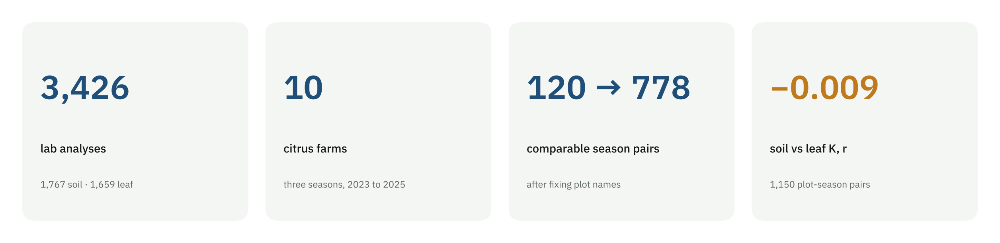

## What the data revealed

### 1. The history was there, spelled differently

Matching plots across seasons by name found almost nothing, because the same
plot was written differently from one sampling batch to the next. Once the
names were standardized, **778 plot-season pairs became comparable instead of
120, 6.5 times more**. No two distinct plots were merged in the process.

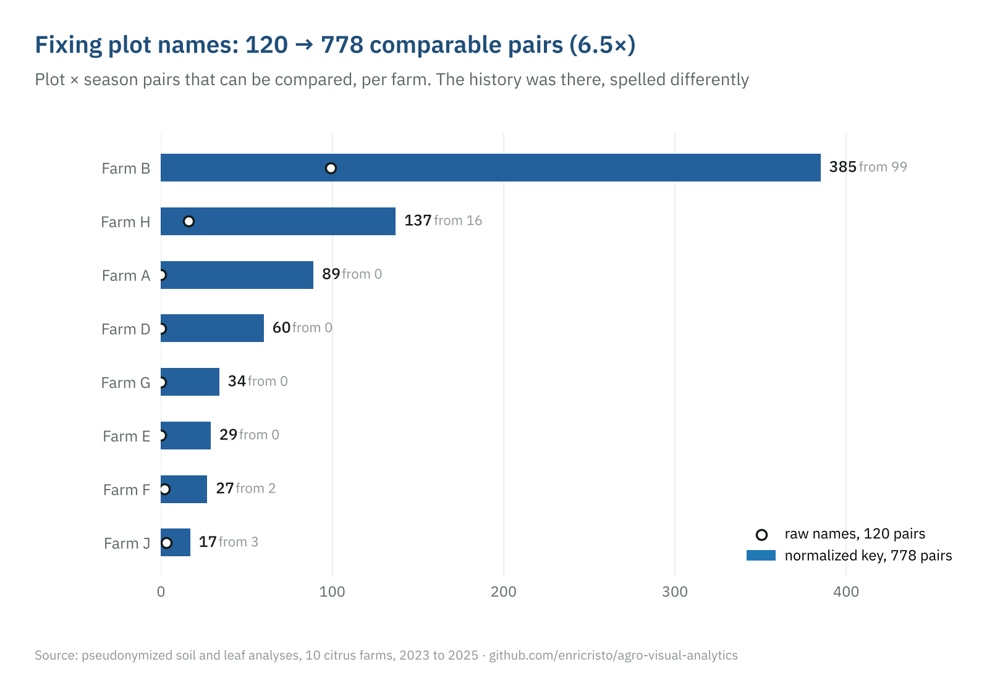

### 2. Missing values have a structure

Copper, iron, manganese and zinc are missing in exactly the same rows: the
analysis was not ordered, nothing failed, and imputing them would be wrong.
The 2024 season is almost absent from the soil data, so most comparisons are
2023 against 2025.

| | |
|---|---|
| 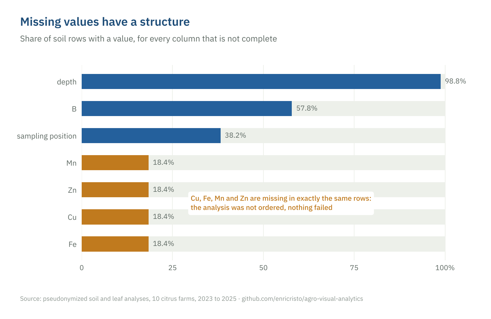 | 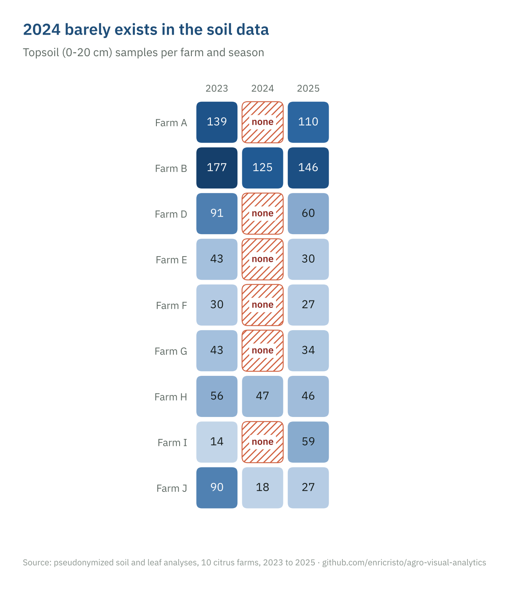 |

### 3. Soil and leaf are decoupled

61% of topsoil samples have potassium in class *Low*, yet soil potassium does
not predict leaf potassium: **r = −0.009 over 1,150 plot-season pairs**.

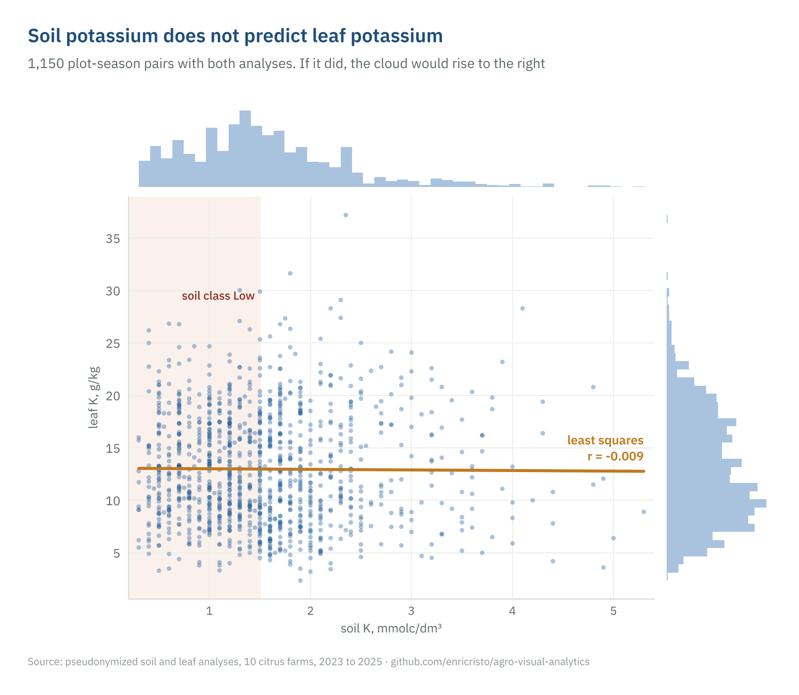

The result holds under three units of analysis (each plot-season, one point per
plot, and each plot against its own mean), and the soil-class by leaf-class
table is indistinguishable from independence (χ² = 1.64, p = 0.80).

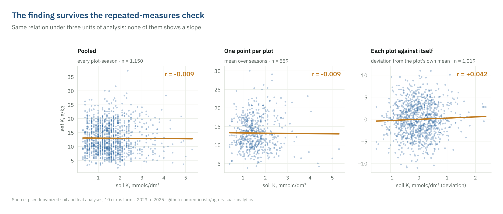
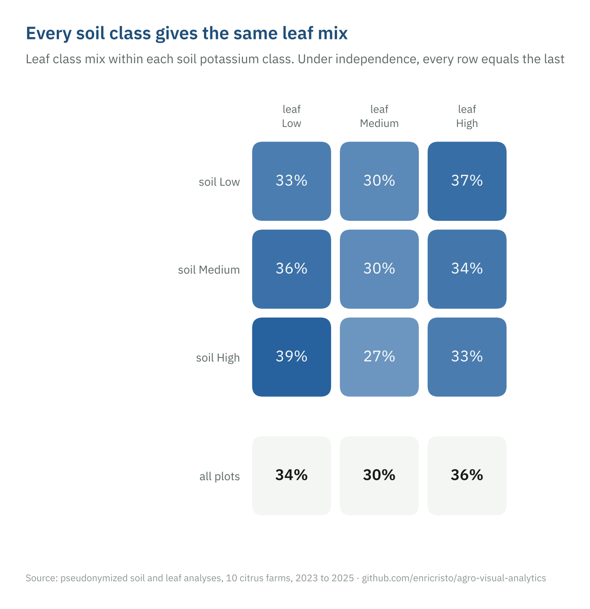

The most likely explanation is the management itself: plots diagnosed low in
the soil receive more potassium, and that shows in the leaf. Soil and leaf
analyses are complementary, not redundant.

### 4. A hypothesis the data rejected

Iron is most often the most limiting nutrient in the DRIS ranking (34.4% of
leaf samples), which suggested iron unavailability in alkaline soil. The soils
are acidic (pH ≈ 5.1) and pH does not differ between groups, so the hypothesis
was rejected.

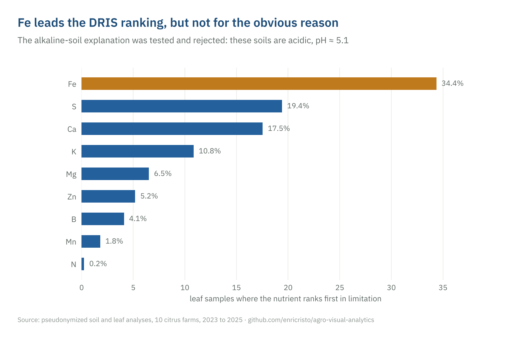

## The same question, several encodings

Keeping the question and the data fixed and changing only the encoding shows
what each chart reveals and hides. Ranking farms by mean soil potassium and by
share of samples in class *Low* agree on seven farms and swap the last two;
that disagreement is what reveals a skewed distribution. A class heatmap shows
in one glance that potassium is low on eight of nine farms and that calcium is
high in the soil but low in the leaf.

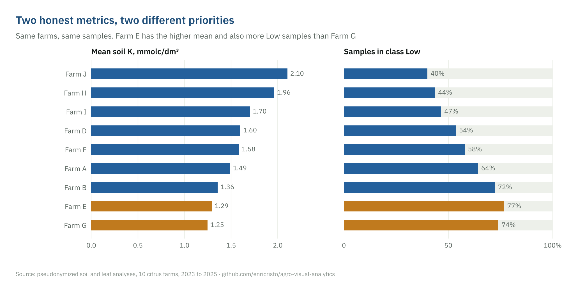
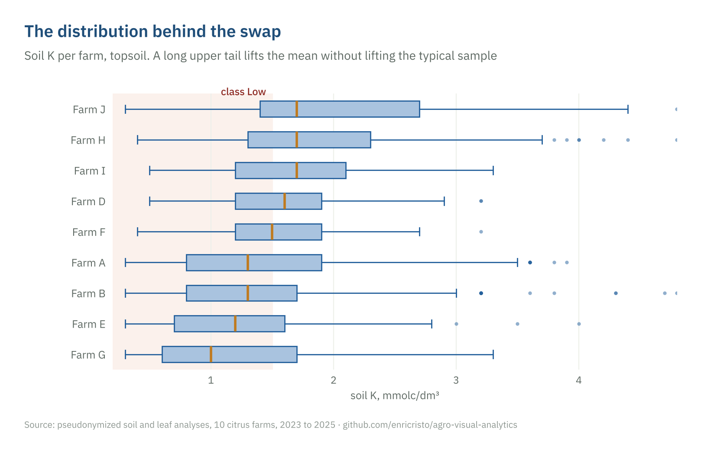
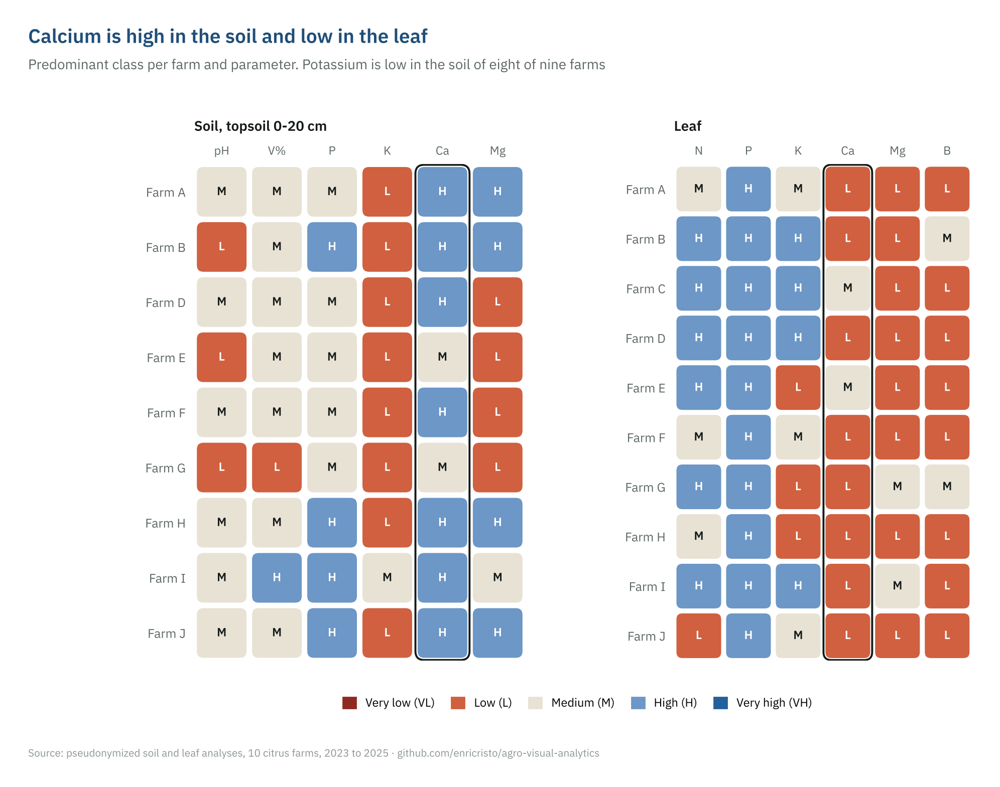

The class scale is diverging and ends in blue, not green: for most nutrients
*very high* is not *good* (excess boron, manganese or zinc is toxic), and a
red-to-green scale would say "more is better". The two-color data palette was
checked for color-vision-deficiency separation.

## Data and code

The observational data belong to third parties. A pseudonymized copy (no farm,
client, laboratory or place names, no coordinates or dates) and the analysis
code can be shared for research or review on request:
**contato@hilum.science**. The SHA-256 fingerprints in
[`VERIFICATION.md`](VERIFICATION.md) let anyone who receives the data confirm
it is the exact dataset behind this page.

## References

- Exploratory data analysis: Tukey (1977); Anscombe (1973).
- Visual analytics: Keim et al. (2008, 2010); Shneiderman (1996); Munzner (2014).
- Graphical perception: Cleveland and McGill (1984).
- Soil and leaf interpretation: Boletim Técnico 100, IAC (2022); Raij et al. (2001); Malavolta (1997).
- DRIS: Jones (1981); Walworth and Sumner (1987).

## Author

Enrico Sonvenso Ambrosio · M.Sc. in Mathematics (UNESP), agronomy student
(Unoeste), researcher at LSNIA, FCT/UNESP ·
[ORCID 0000-0002-6674-3689](https://orcid.org/0000-0002-6674-3689) ·
[LinkedIn](https://www.linkedin.com/in/enricoambrosio) ·
[hilum.science](https://hilum.science/en/)

Text and figures © 2026 Enrico Sonvenso Ambrosio, under
[CC BY-NC-ND 4.0](LICENSE).
